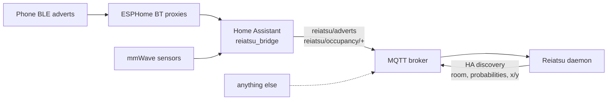

<a id="readme-top"></a>

[![CI][ci-shield]][ci-url]
[![Docker][docker-shield]][docker-url]
[![GHCR][ghcr-shield]][ghcr-url]
[![Issues][issues-shield]][issues-url]
[![MIT License][license-shield]][license-url]

<br />
<div align="center">

<h3 align="center">Reiatsu</h3>

  <p align="center">
    Room-level BLE presence for phones, using walls, doors, mmWave sensors and a guided calibration survey.
    <br />
    <br />
    <a href="https://github.com/arunoruto/reiatsu/issues/new?labels=bug">Report Bug</a>
    &middot;
    <a href="https://github.com/arunoruto/reiatsu/issues/new?labels=enhancement">Request Feature</a>
  </p>
</div>

> [!WARNING]
> **Project status: early, phase 2.** The engine, the simulator, the MQTT daemon with its
> web UI and the Home Assistant bridge work and are tested, but have barely been tried on
> real data. There's no calibration CLI yet, so the daemon runs on the channel priors
> (plus per-receiver P0 overrides).
> Anything marked *planned* below doesn't exist yet.

<details>
  <summary>Table of Contents</summary>
  <ol>
    <li>
      <a href="#about-the-project">About The Project</a>
      <ul>
        <li><a href="#built-with">Built With</a></li>
      </ul>
    </li>
    <li>
      <a href="#getting-started">Getting Started</a>
      <ul>
        <li><a href="#prerequisites">Prerequisites</a></li>
        <li><a href="#installation">Installation</a></li>
      </ul>
    </li>
    <li><a href="#usage">Usage</a></li>
    <li><a href="#roadmap">Roadmap</a></li>
    <li><a href="#contributing">Contributing</a></li>
    <li><a href="#license">License</a></li>
  </ol>
</details>


## About The Project

Reiatsu figures out which room a phone is in (an iPhone resolved via its IRK, for
example), plus a rough position (about 1–2 m), from the BLE adverts that ESPHome
Bluetooth proxies already hear. It runs as a standalone service, zigbee2mqtt style.
Home Assistant is the main target, but it doesn't need HA.

Bermuda and ESPresense mostly go by "the strongest receiver wins". Reiatsu also uses
what they leave out:

1. **Wall-aware channel model.** Expected RSSI is
   `P0_rx − 10·n·log10(d) − Σ loss(material)`, summed over every wall the straight
   line from receiver to phone crosses. Walls come from your room polygons, and each
   has a material (drywall, brick, concrete, glass).
2. **Door-constrained motion.** A grid HMM where people walk at walking speed and
   move between rooms only through doors. A locked iPhone that goes quiet for minutes
   keeps its room while the uncertainty slowly grows.
3. **mmWave fusion.** Per-room (or per-zone, Aqara FP2 style) occupancy feeds the same
   posterior, with false-negative and false-positive rates instead of hard rules.
4. **Guided calibration.** A short survey plus receivers beaconing to each other
   fits P0 per receiver, the path-loss exponent and per-material wall losses
   (Huber loss, with priors). A Gaussian process then learns what the physics
   model misses. A planner tells you where to stand next.



HA's own Bluetooth advertisement stream keeps only the strongest proxy per device,
which is exactly the information Reiatsu can't do without. The small `reiatsu_bridge`
integration subscribes to every advert of your tracked devices from every proxy, and
forwards them to MQTT. The daemon itself speaks only MQTT, so it doesn't need HA.

<p align="right">(<a href="#readme-top">back to top</a>)</p>


### Built With

* [![Python][Python-shield]][Python-url]
* [Leaflet](https://leafletjs.com) and [Leaflet-Geoman](https://geoman.io) (free edition, MIT), vendored in `reiatsu/web/vendor`
* [![NumPy][NumPy-shield]][NumPy-url]
* [![SciPy][SciPy-shield]][SciPy-url]
* [![Nix][Nix-shield]][Nix-url]
* [![Docker][Docker-shield]][Docker-url]

<p align="right">(<a href="#readme-top">back to top</a>)</p>


## Getting Started

### Prerequisites

Either of:

* Nix with flakes enabled
* Python ≥ 3.12 (dependencies: numpy, scipy, pyyaml, paho-mqtt; pytest for the tests)
* Docker

For the Home Assistant bridge: HA ≥ 2026.10 with the Bluetooth and MQTT integrations
set up (e.g. with the Mosquitto add-on).

### Installation

**Home Assistant bridge (HACS)**

1. HACS → ⋮ → *Custom repositories* → add `https://github.com/arunoruto/reiatsu`,
   type *Integration*. Install *Reiatsu Bridge* and restart HA.
2. *Settings → Devices & services → Add integration → Reiatsu Bridge*. Pick the topic
   prefix (default `reiatsu`) and publish interval (default 1 s).
3. *Configure* the entry:
   * **Add a device**: a friendly name plus the phone's IRK (hex or base64, as for
     *Private BLE Device*) or a fixed MAC. The device is published as the slug of
     its name (`Mirza iPhone` → `mirza_iphone`). The IRK stays in the config
     entry: it's never logged or published, and it's redacted from diagnostics.
   * **Name receivers**: a receiver id per Bluetooth scanner. They must match the
     `receivers` ids in your floor plan.
   * **mmWave sensors**: presence binary sensors, each mapped to a room or zone name
     from the floor plan. Sensors sharing a name are combined (occupied if any is on).

Without HACS, copy `custom_components/reiatsu_bridge` into your HA config directory.
The bridge only reads from HA's Bluetooth manager, so Bermuda and *Private BLE
Device* keep working alongside it.

**Nix (dev shell or package)**

```sh
git clone https://github.com/arunoruto/reiatsu.git
cd reiatsu
nix develop                      # python with numpy, scipy, pyyaml, paho-mqtt, pytest
nix build .#reiatsu              # builds the package (with the `reiatsu` daemon) and runs the tests
nix develop .#ha -c pytest tests_ha   # bridge tests against Home Assistant from nixpkgs
```

As a flake input:

```nix
{
  inputs.reiatsu.url = "github:arunoruto/reiatsu";
  # reiatsu.packages.${system}.default is the Python package with the `reiatsu` daemon
}
```

A NixOS module (`services.reiatsu`) is *planned*.

**Python**

```sh
pip install git+https://github.com/arunoruto/reiatsu.git
# or, from a clone, with the test extra:
pip install -e '.[test]'
```

**Docker**

Images for `linux/amd64` and `linux/arm64` are published to
`ghcr.io/arunoruto/reiatsu`: `:edge` follows `main`, and a tag `vX.Y.Z` publishes
`:X.Y.Z`, `:X.Y` and `:latest`. The image runs the daemon, with the floor plan at
`/config/plan.yaml`:

```yaml
# compose.yaml
services:
  reiatsu:
    image: ghcr.io/arunoruto/reiatsu:edge
    restart: unless-stopped
    ports:
      - "8099:8099"                 # web UI: no auth, keep it on the LAN
    volumes:
      - ./config:/config            # plan.yaml, background image, recordings
    environment:
      REIATSU_MQTT_HOST: 192.168.1.10
      REIATSU_MQTT_USER: reiatsu
      REIATSU_MQTT_PASSWORD: ${REIATSU_MQTT_PASSWORD}
      REIATSU_RECORD: /config/record.jsonl   # optional: log raw input for replay
```

The simulator still ships in the image:
`docker run --rm ghcr.io/arunoruto/reiatsu:edge python -m sim.run --scenario quick`.

**Home Assistant add-on**

*Settings → Add-ons → Add-on store → ⋮ → Repositories* → add
`https://github.com/arunoruto/reiatsu`, then install **Reiatsu** (amd64, aarch64; it
pulls the GHCR image matching its version). It needs the Mosquitto broker: the
Supervisor hands the add-on the broker credentials, so there is nothing to configure
apart from the options (record on/off, topic prefix, log level). Open **Reiatsu** in
the sidebar; the web UI runs through ingress, so HA handles the login. The plan, the
background image and `record.jsonl` live in the add-on config folder
(`/addon_configs/<id>_reiatsu/`). The add-on's Documentation tab covers moving over
from a hand-run daemon.

<p align="right">(<a href="#readme-top">back to top</a>)</p>


## Usage

### Daemon

```sh
reiatsu --plan plan.yaml --mqtt-host broker.lan               # live
reiatsu --plan plan.yaml --record record.jsonl                # live, and log the raw input
reiatsu --plan plan.yaml --replay record.jsonl > out.jsonl    # offline: estimates per second
```

Every option also reads an environment variable (`REIATSU_PLAN`, `REIATSU_MQTT_HOST`,
`REIATSU_MQTT_PORT`, `REIATSU_MQTT_USER`, `REIATSU_MQTT_PASSWORD`, `REIATSU_PREFIX`,
`REIATSU_DISCOVERY_PREFIX`, `REIATSU_RECORD`, `REIATSU_HTTP_PORT`, `REIATSU_HTTP_BIND`). Pass the password through the
environment, not the command line. Topics, with the default prefix `reiatsu`:

| topic | direction | payload |
|---|---|---|
| `reiatsu/adverts` | in | `{ts, receiver_id, device_id, rssi}` or a list of them |
| `reiatsu/occupancy/<area>` | in (retained) | `{ts, area, occupied}` |
| `reiatsu/receivers` | in (retained) | `{ts, receivers: [ids online]}`: only these count as "not heard" when silent; until it arrives, all plan receivers do |
| `reiatsu/<device_id>/state` | out | `{ts, room, x, y, sigma, room_probs}` |
| `reiatsu/status` | out (retained) | `online` / `offline` (last will) |
| `homeassistant/sensor/reiatsu_<device_id>/<room\|x\|y\|sigma>/config` | out (retained) | MQTT discovery |

In HA each device shows up with a *Room* sensor (with the room probabilities as
attributes) plus *X*, *Y* and *Position uncertainty* in metres. State is published
when the room changes, otherwise every 5 s (`--publish-interval`). Adverts from
receivers that aren't in the plan are ignored, with one warning per receiver.

### Web UI

The daemon serves a plan editor and live map on port 8099 (`--http-port`, `0` turns it
off; `--http-bind` picks the address). If the plan file doesn't exist yet, the daemon
starts empty and you draw the plan in the UI.

> [!CAUTION]
> The UI has no authentication and can overwrite your plan. Keep it on your LAN (or bind
> it to `127.0.0.1`), or use the Home Assistant add-on, where it sits behind ingress.

* **Background**: upload a PNG or JPEG floor plan, then draw a line of known length to
  set the scale. Or import an ESPresense companion `config.yaml` (rooms and nodes of a
  floor). ESPresense has no doors, so every shared wall gets one to start with.
* **Rooms**: draw polygons or rectangles. Corners snap to other rooms, and nearly square
  corners and nearly aligned edges are straightened. Works without an image too.
* **Walls & doors**: walls are derived from the rooms. Tap one to set its material;
  add doors by tapping a wall and drag them along it. A door on an exterior wall is a
  door to the outside.
* **Receivers**: lists the receivers that are online (from `reiatsu/receivers`) and ids
  seen in adverts. Select one and tap the map to place it, then set its height and an
  optional P0 override.
* **References**: mark a tracked device that never moves (a door lock, say) at its
  known spot. The live view then shows its error against that ground truth.
* **Live**: per device, the probability heatmap, the estimate with its σ circle, room
  probabilities, every receiver's online state and last RSSI, and the rooms whose mmWave
  sensor reports occupied.

Saving writes the plan YAML (keeping `plan.yaml.bak`) and restarts tracking on the new
plan. The YAML stays the source of truth, but comments in it don't survive a save from
the UI. The layout works on a phone, ready for the calibration survey wizard.

The recording is one JSON object per line (`{"type": "advert", ...}` or
`{"type": "occupancy", ...}`, `{"type": "receivers", ...}`). Replay runs it through the same code path as live,
so you can re-run a real day after changing the plan or the tracker.

### Simulator

```sh
python -m sim.run                          # default scenario, seeds 1..5 in parallel, ~1–2 min
python -m sim.run --scenario quick --seeds 1
python -m sim.run --scenario ideal-mmwave  # mmWave in every room, nobody else home
python -m sim.run --check                  # CI: fail if mean room accuracy drops >3 points below sim/expected.json
pytest -q
```

The simulator draws a hidden "true" channel that differs from the priors (wall
losses, receiver offsets, path-loss exponent, a spatially correlated shadowing field).
It adds body shadowing of 0–12 dB depending on which way the person faces,
log-normal fading (σ = 5 dB) and dropped adverts. The phone advertises at 0.5–2 Hz
while awake and only about every 50 s while locked. A person walks between rooms
through the doors and stays a while in each.

The `default` scenario matches the real flat's sensors: mmWave only in the bathroom,
hallway, kitchen and living room. A second, untracked resident also triggers those
sensors, and each sensor raises about one false alarm per hour. The baseline works
like Bermuda: nearest receiver by smoothed distance, with a max-speed filter,
hysteresis and a minimum dwell before switching.

Each config is scored against the truth once per second. "Awake" and "locked" split
room accuracy by the phone's state. "RSSI map err" is the calibrated map's mean
error against the hidden truth.

| config | room acc | acc awake | acc locked | time to correct room (s) | false flips/h | pos err (m) | RSSI map err (dB) |
|---|---:|---:|---:|---:|---:|---:|---:|
| baseline: nearest receiver (Bermuda-like) | 56.8% ± 7.9 | 70.4% ± 5.7 | 51.7% ± 9.0 | 34 ± 6 | 19.8 ± 4.6 | 2.65 ± 0.44 | – |
| priors only | 61.4% ± 8.9 | 70.6% ± 12.3 | 57.4% ± 8.4 | 34 ± 12 | 14.4 ± 4.2 | 1.42 ± 0.19 | 7.2 ± 1.0 |
| node-to-node only | 65.1% ± 2.4 | 78.5% ± 4.6 | 59.8% ± 4.3 | 30 ± 9 | 13.5 ± 2.7 | 1.26 ± 0.08 | 7.2 ± 1.5 |
| survey: starter | 67.8% ± 6.5 | 80.2% ± 8.0 | 62.6% ± 8.5 | 25 ± 12 | 10.8 ± 3.3 | 1.20 ± 0.13 | 1.8 ± 0.3 |
| survey: +10 active | 67.4% ± 3.8 | 79.5% ± 8.7 | 62.5% ± 4.3 | 26 ± 10 | 12.2 ± 3.1 | 1.20 ± 0.13 | 1.6 ± 0.3 |
| survey: +10 random | 68.2% ± 5.2 | 80.6% ± 7.5 | 63.2% ± 7.3 | 25 ± 9 | 10.9 ± 2.6 | 1.20 ± 0.11 | 1.6 ± 0.3 |
| survey: +10 active, no walls | 66.7% ± 5.7 | 79.9% ± 3.5 | 61.5% ± 8.2 | 31 ± 11 | 10.6 ± 4.3 | 1.31 ± 0.12 | 4.4 ± 1.0 |
| survey: +10 active + mmWave | 77.8% ± 3.2 | 85.1% ± 8.2 | 74.8% ± 1.9 | 17 ± 6 | 13.6 ± 1.9 | 1.09 ± 0.10 | 1.6 ± 0.3 |

*`--scenario default`, seeds 1–5, mean ± sd.* What the numbers say so far:

* Most of the remaining error happens while the phone is locked: with one advert
  every ~50 s, a room change shows up only when the next advert arrives.
* Beyond the starter set, more survey points barely help. The map error is already
  down to ~1.7 dB, and per-advert noise (fading plus body shadowing) dominates.
  Active points do no better than random ones here.
* Each device's transmit offset relative to the survey phone is learned online
  (a small discrete posterior marginalized jointly with position). That's why
  node-to-node calibration alone works even though it can't pin the phone's
  absolute power.
* Realistic mmWave coverage adds about 9 points. With sensors in every room and
  nobody else home (`ideal-mmwave`), it reaches about 91%.
* An occupied sensor only mildly pulls the phone into its room (`mmwave_p_other =
  0.5`, since another resident may have triggered it), and the reported room
  switches only on a 0.3 probability lead. Together these cut false flips with
  mmWave from 17 to about 13 per hour at the same accuracy. Letting only "empty" reports
  count (no pull at all) cut flips further but cost about 5 points.
* Old RSSI evidence decays (`evidence_forget = 0.1` per heard step). A device that
  doesn't move repeats the same shadowing and map error every second, and without
  this a single weak receiver drove one room to 100% within a minute. It now stays
  below ~70%. The simulator's fading is independent per advert, so it can't reward
  this, and it costs about a point there.

### Floor plan

Metres, single floor, x right and y down (image convention). The web UI writes this
file. Excerpt of [`examples/flat.yaml`](examples/flat.yaml), plus a few fields the
example doesn't use:

```yaml
max_gap: 0.4                 # edges of two rooms closer than this share a wall
rooms:
  Bathroom: [0, 0, 1.57, 3.27]                       # rectangle x0, y0, x1, y1
  Hallway: [[0, 3.38], [0, 4.6], [6.9, 4.6], [6.9, 3.56], [3.74, 3.56], [3.74, 3.38]]
  # ...
materials: {interior: drywall, exterior: brick}       # defaults for derived walls
walls:                                                # material overrides
  - {rooms: [Bedroom, Living Room], material: concrete} # two rooms: their shared wall
  - {rooms: [Living Room], material: glass}             # one room: its exterior walls
extra_walls:                                          # walls not on a room edge
  - {a: [2.0, 0.0], b: [2.0, 1.0], material: glass}
doors:                                                # the only way between rooms
  - {rooms: [Hallway, Kitchen], at: [2.8, 3.32], width: 0.8}
  - {rooms: [Hallway], at: [0, 4.0], width: 0.9}        # one room: a door to the outside
receivers:                                            # room defaults to the room at x, y
  - {id: lego_space_age, x: 7.2, y: 8.9, z: 1.0}
  - {id: ha_usb, x: 3.4, y: 4.2, z: 0.5, p0: -70}       # P0 override: adapter in a cabinet
references:                                           # stationary devices: ground truth
  - {device: nuki, x: 0.1, y: 4.0}
background: {image: background.png, x: 0, y: 0, scale: 0.0178, opacity: 0.6}  # set by the UI
zones:                                                # optional mmWave zones
  Desk: [5.2, 0.2, 6.7, 1.4]
```

Parallel edges of two rooms within `max_gap` become one interior wall on their
midline. Every other room edge becomes an exterior wall. A door cuts a gap
into the wall between its two rooms, and `at` defaults to the middle of their
longest shared wall.

### Calibration survey

1. **Node-to-node**: every receiver beacons in turn while the others listen.
   You only need the plan for this, and it already beats the priors (see the table).
2. **Starter set** (`starter_points`): room centres, a point ~1 m from each
   receiver, a pair of points on either side of each interior wall, and every
   doorway.
3. **Per point**: stand there for 20–30 s, holding the phone as usual, and turn
   slowly through 360°. Reiatsu keeps the median RSSI per receiver over all adverts
   sent, with the unheard ones counted as below sensitivity. Taking the median of
   only the heard ones would bias weak receivers high. A receiver whose median falls
   below sensitivity counts as "not heard" (censored).
4. **Active learning** (`next_point`): next, stand where the Gaussian process is
   least sure and where the expected fingerprint is easiest to mistake for
   another room.
5. **Weak labels** (`WeakLabel`): readings with only a room attached, such as "phone
   is charging" for the bedroom. They are placed at the most likely spot in that
   room and get a lower weight in the fit.

### Library interface

```python
from reiatsu import Advert, Locator, Occupancy, Tracker, fit, load_plan, make_grid, motion_kernel

plan = load_plan("sim/flat.yaml")             # the simulator's plan, with receivers placed
grid = make_grid(plan)
cal = fit(plan, survey_points, node_links)      # Calibration
mu = cal.predict(plan, grid.xy)                 # expected RSSI per receiver and cell
kernel = motion_kernel(grid)
loc = Locator(lambda: Tracker(grid, mu, [r.id for r in plan.receivers], kernel))

loc.advert(Advert(ts, "kitchen", "phone", -67))
loc.set_occupancy(Occupancy(ts, "Work", True))
for est in loc.tick(ts):                        # about once per second
    print(est.device_id, est.room, est.room_probs, est.x, est.y, est.sigma)
```

<p align="right">(<a href="#readme-top">back to top</a>)</p>


## Roadmap

- [x] Phase 1: engine and simulator (offline)
    - [x] Floor plan YAML, walls derived from room polygons, doors
    - [x] Multi-wall channel model with Student-t and "not heard" likelihood
    - [x] Grid HMM tracker: door-constrained motion, silence handling, mmWave and zones, hysteresis
    - [x] Calibration: Huber fit with priors, node-to-node, GP residual map, weak labels
    - [x] Survey planner: starter set and active learning
    - [x] Simulator, Bermuda-like baseline, metrics and ablations
- [ ] Phase 2: service
    - [x] `reiatsu_bridge` HA integration: every proxy's adverts (IRK or MAC) and mmWave states to MQTT
    - [x] MQTT-only daemon with HA discovery, record and replay
    - [x] Web UI v1: plan editor (image + scale, rooms, walls, doors, receivers, references), ESPresense import, live map
    - [ ] Calibration CLI (survey, node-to-node) and loading fitted parameters in the daemon
    - [x] Home Assistant add-on with ingress, MQTT credentials from the Supervisor
    - [ ] NixOS module `services.reiatsu`
- [ ] Phase 3
    - [ ] Calibration survey wizard in the web UI ("stand here, press, 30 s, next point")
    - [ ] SVG export with per-room ids for [ha-floorplan](https://github.com/ExperienceLovelace/ha-floorplan)

See the [open issues](https://github.com/arunoruto/reiatsu/issues) for a full list of proposed features (and known issues).

<p align="right">(<a href="#readme-top">back to top</a>)</p>


## Contributing

Contributions are welcome. Open an issue first if you plan a larger change.

1. Fork the Project
2. Create your Feature Branch (`git checkout -b feature/AmazingFeature`)
3. Run the tests (`nix develop -c pytest -q` or `pytest -q`; bridge: `nix develop .#ha -c pytest tests_ha`)
4. Commit your Changes (`git commit -m 'Add some AmazingFeature'`)
5. Push to the Branch (`git push origin feature/AmazingFeature`)
6. Open a Pull Request

<p align="right">(<a href="#readme-top">back to top</a>)</p>


## License

Distributed under the MIT License. See [`LICENSE`](LICENSE) for more information.

<p align="right">(<a href="#readme-top">back to top</a>)</p>


[ci-shield]: https://img.shields.io/github/actions/workflow/status/arunoruto/reiatsu/ci.yml?branch=main&style=for-the-badge&label=CI
[ci-url]: https://github.com/arunoruto/reiatsu/actions/workflows/ci.yml
[docker-shield]: https://img.shields.io/github/actions/workflow/status/arunoruto/reiatsu/docker.yml?branch=main&style=for-the-badge&label=image
[docker-url]: https://github.com/arunoruto/reiatsu/actions/workflows/docker.yml
[ghcr-shield]: https://img.shields.io/badge/ghcr.io-arunoruto%2Freiatsu-2496ED?style=for-the-badge&logo=docker&logoColor=white
[ghcr-url]: https://github.com/arunoruto/reiatsu/pkgs/container/reiatsu
[issues-shield]: https://img.shields.io/github/issues/arunoruto/reiatsu.svg?style=for-the-badge
[issues-url]: https://github.com/arunoruto/reiatsu/issues
[license-shield]: https://img.shields.io/github/license/arunoruto/reiatsu.svg?style=for-the-badge
[license-url]: https://github.com/arunoruto/reiatsu/blob/main/LICENSE
[Python-shield]: https://img.shields.io/badge/Python-3776AB?style=for-the-badge&logo=python&logoColor=white
[Python-url]: https://www.python.org/
[NumPy-shield]: https://img.shields.io/badge/NumPy-013243?style=for-the-badge&logo=numpy&logoColor=white
[NumPy-url]: https://numpy.org/
[SciPy-shield]: https://img.shields.io/badge/SciPy-8CAAE6?style=for-the-badge&logo=scipy&logoColor=white
[SciPy-url]: https://scipy.org/
[Nix-shield]: https://img.shields.io/badge/Nix-5277C3?style=for-the-badge&logo=nixos&logoColor=white
[Nix-url]: https://nixos.org/
[Docker-shield]: https://img.shields.io/badge/Docker-2496ED?style=for-the-badge&logo=docker&logoColor=white
[Docker-url]: https://www.docker.com/
