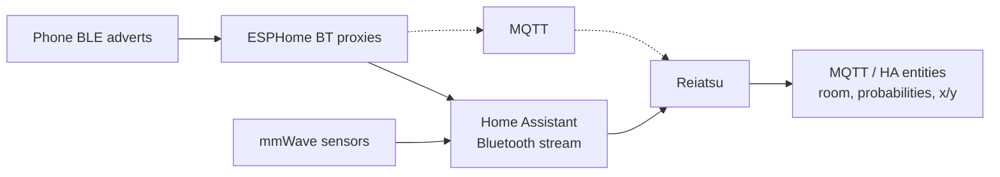

<a id="readme-top"></a>

[![CI][ci-shield]][ci-url]
[![Docker][docker-shield]][docker-url]
[![GHCR][ghcr-shield]][ghcr-url]
[![Issues][issues-shield]][issues-url]
[![MIT License][license-shield]][license-url]

<br />
<div align="center">

<h3 align="center">Reiatsu</h3>

  <p align="center">
    Room-level BLE presence for phones, using walls, doors, mmWave sensors and a guided calibration survey.
    <br />
    <br />
    <a href="https://github.com/arunoruto/reiatsu/issues/new?labels=bug">Report Bug</a>
    &middot;
    <a href="https://github.com/arunoruto/reiatsu/issues/new?labels=enhancement">Request Feature</a>
  </p>
</div>

> [!WARNING]
> **Project status: early, phase 1.** The engine and the simulator work and are tested.
> Nothing talks to Home Assistant or MQTT yet, and the Docker image only runs the simulator.
> Anything marked *planned* below doesn't exist yet.

<details>
  <summary>Table of Contents</summary>
  <ol>
    <li>
      <a href="#about-the-project">About The Project</a>
      <ul>
        <li><a href="#built-with">Built With</a></li>
      </ul>
    </li>
    <li>
      <a href="#getting-started">Getting Started</a>
      <ul>
        <li><a href="#prerequisites">Prerequisites</a></li>
        <li><a href="#installation">Installation</a></li>
      </ul>
    </li>
    <li><a href="#usage">Usage</a></li>
    <li><a href="#roadmap">Roadmap</a></li>
    <li><a href="#contributing">Contributing</a></li>
    <li><a href="#license">License</a></li>
  </ol>
</details>


## About The Project

Reiatsu figures out which room a phone is in (an iPhone resolved via its IRK, for
example), plus a rough position (about 1–2 m), from the BLE adverts that ESPHome
Bluetooth proxies already hear. It runs as a standalone service, zigbee2mqtt style.
Home Assistant is the main target, but it doesn't need HA.

Bermuda and ESPresense mostly go by "the strongest receiver wins". Reiatsu also uses
what they leave out:

1. **Wall-aware channel model.** Expected RSSI is
   `P0_rx − 10·n·log10(d) − Σ loss(material)`, summed over every wall the straight
   line from receiver to phone crosses. Walls come from your room polygons, and each
   has a material (drywall, brick, concrete, glass).
2. **Door-constrained motion.** A grid HMM where people walk at walking speed and
   move between rooms only through doors. A locked iPhone that goes quiet for minutes
   keeps its room while the uncertainty slowly grows.
3. **mmWave fusion.** Per-room (or per-zone, Aqara FP2 style) occupancy feeds the same
   posterior, with false-negative and false-positive rates instead of hard rules.
4. **Guided calibration.** A short survey plus receivers beaconing to each other
   fits P0 per receiver, the path-loss exponent and per-material wall losses
   (Huber loss, with priors). A Gaussian process then learns what the physics
   model misses. A planner tells you where to stand next.



*Phase 1 implements the `Reiatsu` box, fed by the simulator. The input and output
arrows are planned for phase 2.*

<p align="right">(<a href="#readme-top">back to top</a>)</p>


### Built With

* [![Python][Python-shield]][Python-url]
* [![NumPy][NumPy-shield]][NumPy-url]
* [![SciPy][SciPy-shield]][SciPy-url]
* [![Nix][Nix-shield]][Nix-url]
* [![Docker][Docker-shield]][Docker-url]

<p align="right">(<a href="#readme-top">back to top</a>)</p>


## Getting Started

### Prerequisites

Either of:

* Nix with flakes enabled
* Python ≥ 3.12 (dependencies: numpy, scipy, pyyaml; pytest for the tests)
* Docker

### Installation

**Nix (dev shell or package)**

```sh
git clone https://github.com/arunoruto/reiatsu.git
cd reiatsu
nix develop                      # python with numpy, scipy, pyyaml, pytest
nix build .#reiatsu              # builds the package and runs the tests
```

As a flake input:

```nix
{
  inputs.reiatsu.url = "github:arunoruto/reiatsu";
  # reiatsu.packages.${system}.default is the Python package
}
```

A NixOS module (`services.reiatsu`) is *planned* for phase 2, once there is a
service to run.

**Python**

```sh
pip install git+https://github.com/arunoruto/reiatsu.git
# or, from a clone, with the test extra:
pip install -e '.[test]'
```

**Docker**

Images for `linux/amd64` and `linux/arm64` are published to
`ghcr.io/arunoruto/reiatsu`: `:edge` follows `main`, and a tag `vX.Y.Z` publishes
`:X.Y.Z`, `:X.Y` and `:latest`. For now the image runs the simulator:

```sh
docker run --rm ghcr.io/arunoruto/reiatsu:edge
docker run --rm ghcr.io/arunoruto/reiatsu:edge python -m sim.run --scenario quick
```

```yaml
# compose.yaml
services:
  reiatsu:
    image: ghcr.io/arunoruto/reiatsu:edge
    command: python -m sim.run --scenario default
```

GHCR packages start out private. Make it public once under the package settings
(*Package settings → Change visibility*) so pulls work without logging in.

**Home Assistant add-on**: *planned*. This repo will be addable as an add-on
repository, with the add-on using the GHCR images above.

<p align="right">(<a href="#readme-top">back to top</a>)</p>


## Usage

### Simulator

```sh
python -m sim.run                          # default scenario, seeds 1..5 in parallel, ~1–2 min
python -m sim.run --scenario quick --seeds 1
python -m sim.run --scenario ideal-mmwave  # mmWave in every room, nobody else home
python -m sim.run --check                  # CI: fail if mean room accuracy drops >3 points below sim/expected.json
pytest -q
```

The simulator draws a hidden "true" channel that differs from the priors (wall
losses, receiver offsets, path-loss exponent, a spatially correlated shadowing field).
It adds body shadowing of 0–12 dB depending on which way the person faces,
log-normal fading (σ = 5 dB) and dropped adverts. The phone advertises at 0.5–2 Hz
while awake and only about every 50 s while locked. A person walks between rooms
through the doors and stays a while in each.

The `default` scenario matches the real flat's sensors: mmWave only in the bathroom,
hallway, kitchen and living room. A second, untracked resident also triggers those
sensors, and each sensor raises about one false alarm per hour. The baseline works
like Bermuda: nearest receiver by smoothed distance, with a max-speed filter,
hysteresis and a minimum dwell before switching.

Each config is scored against the truth once per second. "Awake" and "locked" split
room accuracy by the phone's state. "RSSI map err" is the calibrated map's mean
error against the hidden truth.

| config | room acc | acc awake | acc locked | time to correct room (s) | false flips/h | pos err (m) | RSSI map err (dB) |
|---|---:|---:|---:|---:|---:|---:|---:|
| baseline: nearest receiver (Bermuda-like) | 56.8% ± 7.9 | 70.4% ± 5.7 | 51.7% ± 9.0 | 34 ± 6 | 19.8 ± 4.6 | 2.65 ± 0.44 | – |
| priors only | 60.4% ± 9.0 | 70.9% ± 13.2 | 55.7% ± 8.8 | 34 ± 15 | 14.6 ± 3.4 | 1.42 ± 0.15 | 7.2 ± 1.0 |
| node-to-node only | 66.2% ± 2.9 | 80.2% ± 3.6 | 60.8% ± 5.2 | 31 ± 8 | 13.7 ± 2.6 | 1.25 ± 0.08 | 7.2 ± 1.5 |
| survey: starter | 68.5% ± 6.0 | 80.5% ± 9.0 | 63.4% ± 8.2 | 25 ± 11 | 11.7 ± 3.3 | 1.18 ± 0.11 | 1.8 ± 0.3 |
| survey: +10 active | 67.7% ± 3.8 | 81.2% ± 9.7 | 62.2% ± 5.0 | 26 ± 10 | 11.3 ± 3.1 | 1.18 ± 0.11 | 1.6 ± 0.3 |
| survey: +10 random | 68.7% ± 5.2 | 81.3% ± 8.5 | 63.4% ± 7.1 | 26 ± 10 | 11.9 ± 4.0 | 1.19 ± 0.11 | 1.6 ± 0.3 |
| survey: +10 active, no walls | 66.3% ± 5.3 | 79.2% ± 5.3 | 61.0% ± 7.8 | 29 ± 12 | 11.0 ± 4.6 | 1.30 ± 0.11 | 4.4 ± 1.0 |
| survey: +10 active + mmWave | 77.0% ± 3.6 | 86.4% ± 9.2 | 73.3% ± 1.9 | 14 ± 6 | 17.3 ± 3.2 | 1.08 ± 0.11 | 1.6 ± 0.3 |

*`--scenario default`, seeds 1–5, mean ± sd.* What the numbers say so far:

* Most of the remaining error happens while the phone is locked: with one advert
  every ~50 s, a room change shows up only when the next advert arrives.
* Beyond the starter set, more survey points barely help. The map error is already
  down to ~1.7 dB, and per-advert noise (fading plus body shadowing) dominates.
  Active points do no better than random ones here.
* Each device's transmit offset relative to the survey phone is learned online
  (a small discrete posterior marginalized jointly with position). That's why
  node-to-node calibration alone works even though it can't pin the phone's
  absolute power.
* Realistic mmWave coverage adds about 9 points. With sensors in every room and
  nobody else home (`ideal-mmwave`), it reaches about 93%.

### Floor plan

Metres, single floor. Excerpt of [`examples/flat.yaml`](examples/flat.yaml), plus `extra_walls`, which the example doesn't use:

```yaml
max_gap: 0.4                 # edges of two rooms closer than this share a wall
rooms:
  Bathroom: [0, 0, 1.57, 3.27]                       # rectangle x0, y0, x1, y1
  Hallway: [[0, 3.38], [0, 4.6], [6.9, 4.6], [6.9, 3.56], [3.74, 3.56], [3.74, 3.38]]
  # ...
materials: {interior: drywall, exterior: brick}       # defaults for derived walls
walls:                                                # per room-pair overrides
  - {rooms: [Bedroom, Living Room], material: concrete}
extra_walls:                                          # walls not on a room edge
  - {a: [2.0, 0.0], b: [2.0, 1.0], material: glass}
doors:                                                # the only way between rooms
  - {rooms: [Hallway, Kitchen], at: [2.8, 3.32], width: 0.8}
receivers:
  - {id: kitchen, x: 1.7, y: 3.26, z: 1.0, room: Kitchen}
zones:                                                # optional mmWave zones
  Desk: [5.2, 0.2, 6.7, 1.4]
```

Parallel edges of two rooms within `max_gap` become one interior wall on their
midline. Every other room edge becomes an exterior wall. A door cuts a gap
into the wall between its two rooms, and `at` defaults to the middle of their
longest shared wall.

### Calibration survey

1. **Node-to-node**: every receiver beacons in turn while the others listen.
   You only need the plan for this, and it already beats the priors (see the table).
2. **Starter set** (`starter_points`): room centres, a point ~1 m from each
   receiver, a pair of points on either side of each interior wall, and every
   doorway.
3. **Per point**: stand there for 20–30 s, holding the phone as usual, and turn
   slowly through 360°. Reiatsu keeps the median RSSI per receiver over all adverts
   sent, with the unheard ones counted as below sensitivity. Taking the median of
   only the heard ones would bias weak receivers high. A receiver whose median falls
   below sensitivity counts as "not heard" (censored).
4. **Active learning** (`next_point`): next, stand where the Gaussian process is
   least sure and where the expected fingerprint is easiest to mistake for
   another room.
5. **Weak labels** (`WeakLabel`): readings with only a room attached, such as "phone
   is charging" for the bedroom. They are placed at the most likely spot in that
   room and get a lower weight in the fit.

### Library interface

```python
from reiatsu import Advert, Locator, Occupancy, Tracker, fit, load_plan, make_grid, motion_kernel

plan = load_plan("examples/flat.yaml")
grid = make_grid(plan)
cal = fit(plan, survey_points, node_links)      # Calibration
mu = cal.predict(plan, grid.xy)                 # expected RSSI per receiver and cell
kernel = motion_kernel(grid)
loc = Locator(lambda: Tracker(grid, mu, [r.id for r in plan.receivers], kernel))

loc.advert(Advert(ts, "kitchen", "phone", -67))
loc.set_occupancy(Occupancy(ts, "Work", True))
for est in loc.tick(ts):                        # about once per second
    print(est.device_id, est.room, est.room_probs, est.x, est.y, est.sigma)
```

<p align="right">(<a href="#readme-top">back to top</a>)</p>


## Roadmap

- [x] Phase 1: engine and simulator (offline)
    - [x] Floor plan YAML, walls derived from room polygons, doors
    - [x] Multi-wall channel model with Student-t and "not heard" likelihood
    - [x] Grid HMM tracker: door-constrained motion, silence handling, mmWave and zones, hysteresis
    - [x] Calibration: Huber fit with priors, node-to-node, GP residual map, weak labels
    - [x] Survey planner: starter set and active learning
    - [x] Simulator, Bermuda-like baseline, metrics and ablations
- [ ] Phase 2: service
    - [ ] Input from Home Assistant's Bluetooth advertisement stream (stock ESPHome proxies)
    - [ ] Generic MQTT input for setups without HA
    - [ ] MQTT output with HA discovery
    - [ ] NixOS module `services.reiatsu`, Home Assistant add-on
- [ ] Phase 3: web UI (floor plan editor, live map, calibration survey wizard)

See the [open issues](https://github.com/arunoruto/reiatsu/issues) for a full list of proposed features (and known issues).

<p align="right">(<a href="#readme-top">back to top</a>)</p>


## Contributing

Contributions are welcome. Open an issue first if you plan a larger change.

1. Fork the Project
2. Create your Feature Branch (`git checkout -b feature/AmazingFeature`)
3. Run the tests (`nix develop -c pytest -q` or `pytest -q`)
4. Commit your Changes (`git commit -m 'Add some AmazingFeature'`)
5. Push to the Branch (`git push origin feature/AmazingFeature`)
6. Open a Pull Request

<p align="right">(<a href="#readme-top">back to top</a>)</p>


## License

Distributed under the MIT License. See [`LICENSE`](LICENSE) for more information.

<p align="right">(<a href="#readme-top">back to top</a>)</p>


[ci-shield]: https://img.shields.io/github/actions/workflow/status/arunoruto/reiatsu/ci.yml?branch=main&style=for-the-badge&label=CI
[ci-url]: https://github.com/arunoruto/reiatsu/actions/workflows/ci.yml
[docker-shield]: https://img.shields.io/github/actions/workflow/status/arunoruto/reiatsu/docker.yml?branch=main&style=for-the-badge&label=image
[docker-url]: https://github.com/arunoruto/reiatsu/actions/workflows/docker.yml
[ghcr-shield]: https://img.shields.io/badge/ghcr.io-arunoruto%2Freiatsu-2496ED?style=for-the-badge&logo=docker&logoColor=white
[ghcr-url]: https://github.com/arunoruto/reiatsu/pkgs/container/reiatsu
[issues-shield]: https://img.shields.io/github/issues/arunoruto/reiatsu.svg?style=for-the-badge
[issues-url]: https://github.com/arunoruto/reiatsu/issues
[license-shield]: https://img.shields.io/github/license/arunoruto/reiatsu.svg?style=for-the-badge
[license-url]: https://github.com/arunoruto/reiatsu/blob/main/LICENSE
[Python-shield]: https://img.shields.io/badge/Python-3776AB?style=for-the-badge&logo=python&logoColor=white
[Python-url]: https://www.python.org/
[NumPy-shield]: https://img.shields.io/badge/NumPy-013243?style=for-the-badge&logo=numpy&logoColor=white
[NumPy-url]: https://numpy.org/
[SciPy-shield]: https://img.shields.io/badge/SciPy-8CAAE6?style=for-the-badge&logo=scipy&logoColor=white
[SciPy-url]: https://scipy.org/
[Nix-shield]: https://img.shields.io/badge/Nix-5277C3?style=for-the-badge&logo=nixos&logoColor=white
[Nix-url]: https://nixos.org/
[Docker-shield]: https://img.shields.io/badge/Docker-2496ED?style=for-the-badge&logo=docker&logoColor=white
[Docker-url]: https://www.docker.com/
