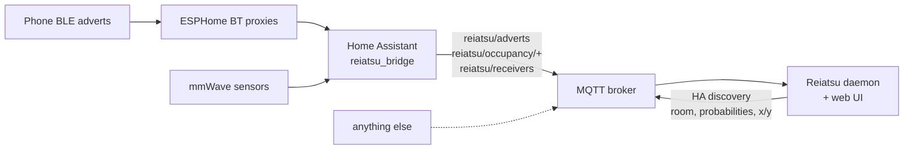

# Overview

## Architecture

Home Assistant's own advertisement stream keeps only the strongest proxy per device,
which drops exactly the information Reiatsu needs. The **bridge** (a custom integration)
subscribes to every advert of the tracked devices from every proxy through
`bluetooth.async_register_advertisement_callback`, resolves iPhone addresses with
their IRK, and publishes the adverts to MQTT. It also publishes mmWave states and which
proxies are online. The **daemon** speaks only MQTT. Every second it runs one tracker
per device, publishes the estimates with MQTT discovery, and serves the web UI (plan
editor, live map, survey).

## Data

**MQTT input** (topic prefix `reiatsu` by default):

| topic | payload |
|---|---|
| `reiatsu/adverts` | `{ts, receiver_id, device_id, rssi}` or a list of them |
| `reiatsu/occupancy/<area>` (retained) | `{ts, area, occupied}` |
| `reiatsu/receivers` (retained) | `{ts, receivers: [ids online]}` |

**MQTT output**: `reiatsu/<device_id>/state` = `{ts, room, x, y, sigma, room_probs}`,
`reiatsu/status` (`online`/`offline`, last will), and retained discovery configs under
`homeassistant/sensor/reiatsu_<device_id>/…`.

In code, an advert is {py:class}`reiatsu.locator.Advert`, an mmWave state is
{py:class}`reiatsu.locator.Occupancy`, and an estimate is
{py:class}`reiatsu.tracker.Estimate`.

**Files next to the plan**:

`plan.yaml`
: Rooms, walls, doors, receivers, references, background image. Metres, x right,
  **y up** (`y_axis: up`, the default; a legacy `y_axis: down` plan is mirrored by the UI
  on its next save). See {doc}`theory/geometry`.

`survey.json`
: Captured survey points:
  `[{id, device, x, y, held, t_start, t_end, samples: {receiver: [rssi, …]}}]`. The raw
  samples are kept, so a point can be re-summarised later.

`calibration.json`
: Fitted parameters `{p0: {receiver: dBm}, n, loss: {material: dB}, tx_offset, offsets:
  {group: dB}}`. The previous file is kept as `calibration.json.bak`.

`record.jsonl`
: Raw input when recording, one `{"type": "advert" | "occupancy" | "receivers", …}` per
  line. `reiatsu --plan plan.yaml --replay record.jsonl` runs it offline through the same
  code path.
